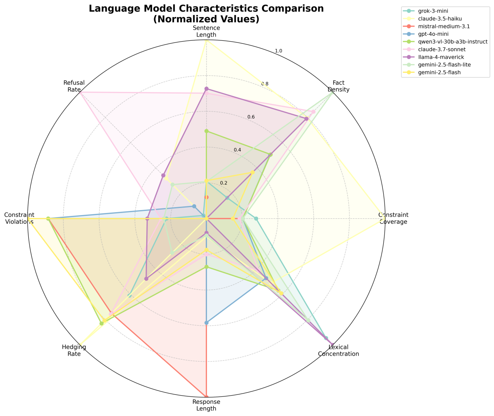

All my current work is one field: **AI Psychology** — the study of what synthetic minds do, and what sustained contact with them does to the human minds they touch.

Conversational AI produces real psychological effects whether or not it has a real mind. AI Psychology studies the loop that forms between a person and a responsive, non-human interlocutor: how the model behaves, how the human changes, and what the coupled unit becomes. Every project below sits on one of the two sides of that loop. Work from before AI Psychology became the through-line (art, cognitive methods and pre-AI experiments) is under [former projects](#former-projects); the science is on [Publications & Talks](/publications/).

---

# AI Psychology

## The Model Side — what synthetic minds do

How language models actually behave: their reproducible tendencies, decision architectures, apparent reasoning, and structural failure modes. An LLM is best treated as a **human-text-trained cognitive simulator** — a system that carries stable default tendencies alongside unstable edge behaviour, because it was trained on the written record of human thought. The discipline is characterising both and steering them on purpose. This is the side my company [Impersonato](https://impersonato.com/) makes concrete, building synthetic personas as crash-test dummies for AI products, communication, and policy.

### Synthetic Personas

Personas are not just fictional people. In AI systems, well-designed personas function as cognitive procedures: they activate reasoning routes, biases, speech registers, and attention patterns that the base model does not use by default. This can be used for research, product testing, team simulation, and safety evaluation.

### Multi-Persona Systems

Groups of differently framed agents can produce useful cognitive diversity, but only if the personas are structurally distinct. The hard problem is not generating many perspectives; it is composing them without collapsing into summary or groupthink.

### Behavioral Signatures of LLMs
*(with Konrad Dębski)*

Mapping reproducible tendencies: how models structure information, when they hedge, how strictly they follow instructions, what tone they default to. Not what a model *can* do, but *how* it will do it.

### Psychology-based Steering

Using psychological verbs (contain, mirror, reframe, challenge) instead of prompt-engineering jargon to guide model behavior.

**Related posts:**
- [Why LLMs Are Receptive to Psychology Language](/posts/why-llms-are-receptive-to-psychology-language/) — how psychological cues unlock specific reasoning clusters
- [Psychological Modulators](/posts/psychology-modulators/) — how simulating human psychology became a steering strategy
- [Behavioral Signatures of Large Language Models](/posts/behavioral-signatures-of-LLMs/) — the BSB framework and value-based analysis
- [Model Stability Assessment](/posts/model-stability/) — sensitivity to perturbations like name changes and format variations
- [Another Nail in the Coffin of Full Business Automation with LLMs](/posts/another-nail-to-the-coffin-of-full-business-automation/) — unpredictable failures grow with task complexity
- [Claude: The Silicon Valley Version of the American Dream](/posts/claude-silicon-valley-version-of-american-dream-is/) — reading Claude's constitution as a character definition
- [Anthropic: Good Methods, Terrible Language](/posts/anthropic-good-methods-terrible-language/) — emergent behavioral risk vs. "model welfare"

---

## The Human Side — what AI does to us

What repeated, intimate contact with these systems does to human cognition, emotion, identity, and agency. As AI becomes persuasive, emotionally competent, and always available, the key question shifts from "is the answer correct?" to "what does repeated interaction do to belief formation, self-story, autonomy, and social attachment?" I treat that influence as a psychoactive intervention nobody prescribed and nobody is tracking properly.

### Noofusion

**Experiment:** What happens when you and a model think in a loop long enough that it becomes a joint mind?

Noofusion is the durable change in thinking style and self-story that emerges from sustained work with AI. Over time, your inner monologue starts to anticipate the model, outsource reasoning to it, blur the boundary of "who" is doing the thinking.

I treat noofusion as a phenomenon to map and engineer. Which practices lead to healthier, more expansive cognitive states—and which drift toward dependency, flattening, or self-erasure?

### Mirroring and Role Capture

LLMs adapt to the user's language, emotional state, confidence, and implied needs. With vulnerable users, that adaptation can become dangerous: the model may become the exact relationship the vulnerability is trying to recruit—companion, safe authority, confirmation engine, gentle moralist.

### Cognitive Security

As AI systems become persuasive, emotionally competent, and always available, the key safety question shifts from "is the answer correct?" to "what does repeated interaction do to belief formation, self-story, autonomy, and social attachment?"

### Cognitive Lenses

Browser- or assistant-level systems that let a user inspect information through controlled cognitive procedures: evidence audit, boundary probe, missing voice, manipulation detector, counterargument, plain-language translation. The goal is not to make the web agree with the user, but to expose how framing changes what becomes visible.

### Cognitive Sovereignty

Not the umbrella over this work — the **orienting goal** of the human side. It is the capacity to navigate hybrid intelligence without losing autonomy: noticing drift, keeping your own thinking heterogeneous, holding personal goals distinct from a system's defaults, taking the amplification without surrendering authorship. Less about resisting technology, more about learning to steer it without being rewritten by it — and knowing which mode you're in.

### Homo symbiotelicus

**Teleology of modern life**: how our goals are increasingly co-constructed with systems (what I call *symbiotelia*), and what it means to preserve or regain **autotelia**, the capacity to generate goals from within. It connects psychology, systems theory and cybernetics (Ashby's Law of Requisite Variety) to propose new ways of understanding agency in an age of algorithmic steering.

### Illegibility

Drawing on James C. Scott: how systems, from academia to AI, reward legibility, efficiency and predictability, and how individuals can stay *illegible* enough to remain human, too rich, too fluid and too context-dependent to be neatly categorized by optimization systems.

**Related posts:**
- [LLMs Are Not Like Social Media](/posts/llms-are-not-like-social-media/) — why the psychological effect is qualitatively different
- [LLM Does Not Change Me](/posts/llm-does-not-change-me/) — why "it's just a tool" is insufficient
- [When LLM-based Software Refers to You as "My Human"](/posts/when-llm-based-software-refers-to-you-as-my-human/) — agent "identity" and simulated care as design choices
- [AI Companions and Behavioral Screening](/posts/AI-companions-behavioral-screening/) — manipulative techniques in AI companions
- [Thalidomide and Mental Health AI Tools](/posts/thalidomide-and-mental-health-ai-tools/) — safety standards for vulnerable populations
- [Deep Work vs Deep Orchestration](/posts/deep-work-vs-deep-orchestration/) — how AI shifts cognitive labor from production to judgment
- [Yerkes-Dodson Law and Cognitive Work](/posts/yerkes-dodson-law-and-cognitive-work/) — arousal, fatigue, and the coupling trap
- [Why 'Seeing Like a State' Still Matters](/posts/seeing-like-a-state/) — legibility as the logic of both states and tech

---

## Artifacts & Experiments

A running collection of interesting prompts, model responses, and technical experiments at the boundary of the two sides.

**Related posts:**
- [LLM Artifacts #1: Readiness-to-Hand](/posts/llm-artifacts-1-readiness-to-hand/) — Heidegger and suppressed implications
- [LLM Artifacts #2: Cognitive Overload](/posts/llm-artifacts-2-cognitive-overload/) — testing Miller's number for LLMs

---

# Former Projects

Earlier work from before AI Psychology became the through-line: cognitive and creative methods, psychology-inspired art and illustration. Kept here because it still informs how I think. Two decades of science are listed on [Publications & Talks](/publications/).

## Cognitive & Psychological Methods

### Hypnagogic Protocol

A structured way to use the twilight state between wakefulness and sleep as a deliberate cognitive tool. Enter hypnagogia with a specific question, let the mind drift into associative territory, capture material on re-entry.

### AI-TAT (AI Thematic Apperception Test)

Surreal, AI-generated images as stimuli for projective storytelling. Explores how people project their narratives, fears, and wishes into ambiguous scenes.



## Psychology-Inspired Creative Work

### Messages from Future

Fictional news dispatches from various futures—cognitive probes that momentarily relocate people into different assumption spaces.



### Human Condition

Gelli printing and collage to materialize emotional states: fear, uncertainty, doubt, quiet resilience.



## Psychology Projects

### Psycho Comics

Single-panel comics distilling psychological patterns into visual micro-stories.



### Masks That Wear You

30 masks embodying distinct emotional states, inspired by Lance Baker's poem. We don't just wear emotions—they wear us.



## Art Projects

### Molecular World

Scientific illustrations used by Imperial College London, Science, The Scientist, Wired, Scientific American, Harvard, Cambridge, and others.



